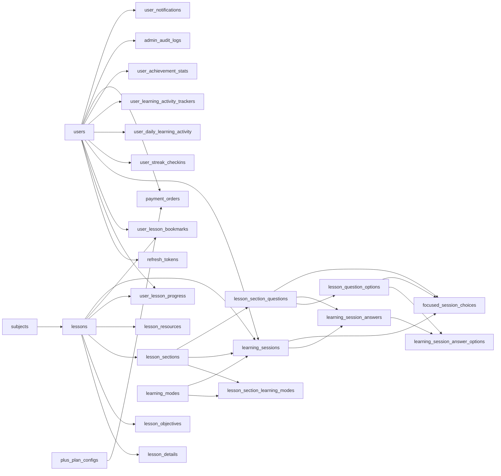

# Từ điển dữ liệu BE Tera Learn

> Cập nhật theo mã nguồn ngày **20/09/2026**. Tài liệu được đối chiếu từ toàn bộ Flyway migration `V1` đến `V25`, các JPA entity và các JDBC repository trong `BE-tera-learn`.

## 1. Phạm vi và quy ước

- Hệ quản trị cơ sở dữ liệu: **PostgreSQL**.
- Schema nghiệp vụ: **`tera`**.
- Tổng số bảng nghiệp vụ hiện tại: **28 bảng**.
- Không tính bảng kỹ thuật `flyway_schema_history` do Flyway tự quản lý.
- Hai bảng tạm `learning_session_merge_map` và `learning_answer_merge_map` trong migration `V10` chỉ tồn tại trong lúc migrate, không thuộc schema hiện tại.
- Ví dụ trong tài liệu là dữ liệu minh họa hợp lệ theo schema. Một số ví dụ giống dữ liệu seed nhưng không cam kết luôn tồn tại ở mọi môi trường.
- `PK`: khóa chính; `FK`: khóa ngoại; `UK`: giá trị duy nhất; `NULL`: được phép để trống.
- `TIMESTAMPTZ` là thời điểm có múi giờ. API thường biểu diễn dưới dạng ISO-8601, ví dụ `2026-09-19T08:30:00Z`.
- Với các bảng dùng `BIGSERIAL`, PostgreSQL tự sinh `id` tăng dần.

## 2. Danh sách bảng theo nhóm

| Nhóm | Số bảng | Các bảng |
|---|---:|---|
| Tài khoản và xác thực | 3 | `users`, `refresh_tokens`, `email_verifications` |
| Danh mục và nội dung bài học | 6 | `subjects`, `lessons`, `lesson_details`, `lesson_objectives`, `lesson_sections`, `lesson_resources` |
| Chế độ học, câu hỏi và phiên học | 8 | `learning_modes`, `lesson_section_learning_modes`, `learning_sessions`, `lesson_section_questions`, `lesson_question_options`, `learning_session_answers`, `learning_session_answer_options`, `focused_session_choices` |
| Tiến độ, hoạt động và thành tích | 6 | `user_lesson_progress`, `user_lesson_bookmarks`, `user_streak_checkins`, `user_daily_learning_activity`, `user_learning_activity_trackers`, `user_achievement_stats` |
| Tera Plus và thanh toán | 3 | `plus_plan_configs`, `payment_orders`, `payment_webhook_events` |
| Vận hành CMS và thông báo | 2 | `admin_audit_logs`, `user_notifications` |

## 3. Quan hệ chính

Các bảng có `ON DELETE CASCADE` sẽ tự xóa dữ liệu con khi dữ liệu cha bị xóa. Riêng `admin_audit_logs.actor_user_id` dùng `ON DELETE SET NULL` để lịch sử quản trị vẫn được giữ lại sau khi tài khoản quản trị bị xóa.

---

## 4. Tài khoản và xác thực

### 4.1. `users`

**Mục đích:** Lưu tài khoản học viên/quản trị viên, trạng thái xác thực, liên kết Google và quyền Tera Plus hiện tại.

| Cột | Kiểu và ràng buộc | Ý nghĩa | Ví dụ |
|---|---|---|---|
| `id` | `BIGSERIAL`, PK | Định danh nội bộ của người dùng. | `42` |
| `email` | `VARCHAR(255)`, NOT NULL, UK | Email đăng nhập; không được trùng giữa các tài khoản. | `minh.nguyen@example.com` |
| `password_hash` | `VARCHAR(60)`, NULL | Mật khẩu đã băm, không lưu mật khẩu thuần. Có thể `NULL` với tài khoản chỉ đăng nhập Google. | `$2a$10$...` |
| `display_name` | `VARCHAR(100)`, NULL | Tên hiển thị trên giao diện. | `Nguyễn Minh` |
| `role` | `VARCHAR(10)`, NOT NULL, mặc định `USER` | Phân quyền tài khoản: `USER` hoặc `ADMIN`. | `USER` |
| `google_id` | `VARCHAR(255)`, NULL | Định danh người dùng do Google cấp, dùng để ghép tài khoản OAuth. | `108234567890123456789` |
| `created_at` | `TIMESTAMPTZ`, NOT NULL, mặc định `NOW()` | Thời điểm tạo tài khoản. | `2026-09-19T08:30:00Z` |
| `status` | `VARCHAR(20)`, NOT NULL, mặc định `ACTIVE` | Trạng thái tài khoản: `PENDING`, `ACTIVE`, `LOCK`, `DELETE`. | `ACTIVE` |
| `plus_starts_at` | `TIMESTAMPTZ`, NULL | Thời điểm quyền Tera Plus bắt đầu có hiệu lực. `NULL` nếu chưa từng kích hoạt. | `2026-09-19T09:00:00Z` |
| `plus_expires_at` | `TIMESTAMPTZ`, NULL | Thời điểm Plus hết hạn. Gói trọn đời được service ghi mốc `9999-12-31T23:59:59Z`; `NULL` không tự động có nghĩa là trọn đời. | `2027-09-19T09:00:00Z` |

**Ví dụ bản ghi:** tài khoản `minh.nguyen@example.com`, vai trò `USER`, trạng thái `ACTIVE`, Plus có hiệu lực từ `19/09/2026` đến `19/09/2027`.

**Ràng buộc/index quan trọng:** email duy nhất; index `google_id`; DB kiểm tra tập giá trị của `role` và `status`.

### 4.2. `refresh_tokens`

**Mục đích:** Lưu refresh token đã băm để cấp lại access token và chủ động thu hồi phiên đăng nhập.

| Cột | Kiểu và ràng buộc | Ý nghĩa | Ví dụ |
|---|---|---|---|
| `id` | `BIGSERIAL`, PK | Định danh refresh token. | `815` |
| `user_id` | `BIGINT`, FK → `users.id`, NOT NULL, CASCADE | Chủ sở hữu token. | `42` |
| `token_hash` | `VARCHAR(64)`, NOT NULL, UK | Giá trị băm của refresh token; không lưu token gốc. | `65a89e...9c21` |
| `expires_at` | `TIMESTAMPTZ`, NOT NULL | Thời điểm token hết hạn. | `2026-10-19T08:30:00Z` |
| `revoked` | `BOOLEAN`, NOT NULL, mặc định `FALSE` | Token đã bị thu hồi hay chưa. | `false` |
| `created_at` | `TIMESTAMPTZ`, NOT NULL, mặc định `NOW()` | Thời điểm phát hành token. | `2026-09-19T08:30:00Z` |

**Ví dụ bản ghi:** token số `815` thuộc user `42`, còn hiệu lực đến `19/10/2026` và chưa bị thu hồi.

**Ràng buộc/index quan trọng:** `token_hash` duy nhất; có index theo `user_id` và `token_hash`; xóa user sẽ xóa toàn bộ refresh token tương ứng.

### 4.3. `email_verifications`

**Mục đích:** Quản lý mã xác minh email có thời hạn trong luồng đăng ký/xác thực tài khoản.

| Cột | Kiểu và ràng buộc | Ý nghĩa | Ví dụ |
|---|---|---|---|
| `id` | `BIGSERIAL`, PK | Định danh yêu cầu xác minh. | `231` |
| `email` | `VARCHAR(255)`, NOT NULL | Email cần xác minh. | `minh.nguyen@example.com` |
| `code_hash` | `VARCHAR(64)`, NOT NULL | Mã OTP đã băm; DB không lưu OTP thuần. | `b7f95d...a310` |
| `expires_at` | `TIMESTAMPTZ`, NOT NULL | Thời điểm OTP hết hiệu lực. | `2026-09-19T08:40:00Z` |
| `attempts` | `SMALLINT`, NOT NULL, mặc định `0`, ≥ 0 | Số lần người dùng đã thử nhập mã. | `1` |
| `used` | `BOOLEAN`, NOT NULL, mặc định `FALSE` | Mã đã được sử dụng thành công hay chưa. | `false` |
| `created_at` | `TIMESTAMPTZ`, NOT NULL, mặc định `NOW()` | Thời điểm sinh mã. | `2026-09-19T08:30:00Z` |

**Ví dụ bản ghi:** OTP cho `minh.nguyen@example.com`, đã thử một lần, chưa dùng và hết hạn sau 10 phút.

**Ràng buộc/index quan trọng:** index `(email, created_at DESC)` để tìm mã mới nhất; index `(email, used, expires_at)` để tìm mã còn hiệu lực.

---

## 5. Danh mục và nội dung bài học

### 5.1. `subjects`

**Mục đích:** Danh mục môn học dùng chung cho CMS, bộ lọc và trang khám phá bài học.

| Cột | Kiểu và ràng buộc | Ý nghĩa | Ví dụ |
|---|---|---|---|
| `id` | `BIGSERIAL`, PK | Định danh môn học. | `1` |
| `code` | `VARCHAR(30)`, NOT NULL, UK | Mã ổn định để backend/frontend xử lý. Các mã seed: `LITERATURE`, `HISTORY`, `GEOGRAPHY`, `ECONOMICS_LAW`. | `LITERATURE` |
| `name` | `VARCHAR(100)`, NOT NULL | Tên đầy đủ. | `Ngữ văn` |
| `short_name` | `VARCHAR(50)`, NOT NULL | Tên rút gọn dùng ở vị trí hẹp. | `Ngữ văn` |
| `accent` | `VARCHAR(20)`, NOT NULL | Khóa màu giao diện của môn học. | `PINK` |
| `sort_order` | `SMALLINT`, NOT NULL, mặc định `0` | Thứ tự hiển thị tăng dần. | `1` |
| `active` | `BOOLEAN`, NOT NULL, mặc định `TRUE` | Có cho phép môn học xuất hiện/được sử dụng hay không. | `true` |

**Ví dụ bản ghi:** môn `Ngữ văn`, mã `LITERATURE`, màu `PINK`, đứng đầu danh sách và đang hoạt động.

### 5.2. `lessons`

**Mục đích:** Bảng trung tâm của kho học liệu; mỗi dòng là một chủ đề/bài học thuộc một môn và một lớp.

| Cột | Kiểu và ràng buộc | Ý nghĩa | Ví dụ |
|---|---|---|---|
| `id` | `BIGSERIAL`, PK | Định danh bài học. | `10` |
| `subject_id` | `BIGINT`, FK → `subjects.id`, NOT NULL | Môn học chứa bài này. | `1` |
| `slug` | `VARCHAR(180)`, NOT NULL, UK | Đường dẫn thân thiện và định danh công khai của bài học. | `doc-hieu-van-ban-thong-tin` |
| `grade` | `SMALLINT`, NOT NULL, từ 10 đến 12 | Khối lớp áp dụng. | `10` |
| `title` | `VARCHAR(180)`, NOT NULL | Tên bài/chủ đề. | `Đọc hiểu văn bản thông tin` |
| `description` | `VARCHAR(700)`, NOT NULL | Mô tả ngắn dùng ở thẻ và trang chi tiết. | `Nhận biết cấu trúc, luận đề và cách khai thác dữ kiện...` |
| `thumbnail_url` | `VARCHAR(1000)`, NULL | URL ảnh bìa công khai. Khi `NULL`, frontend dùng ảnh minh họa mặc định. | `https://cdn.example.com/lessons/doc-hieu.webp` |
| `difficulty` | `VARCHAR(20)`, NOT NULL | Độ khó: `BASIC`, `APPLICATION`, `ADVANCED`. | `BASIC` |
| `program` | `VARCHAR(20)`, NOT NULL | Chương trình: `GDPT_2018` hoặc `THPT_EXAM`. | `GDPT_2018` |
| `total_units` | `SMALLINT`, NOT NULL, > 0 | Tổng số phần học của bài; về nghiệp vụ nên khớp số `lesson_sections`. | `7` |
| `focused_time_limit_minutes` | `INTEGER`, NOT NULL, từ 1 đến 1440 | Thời lượng đếm ngược cho cả chủ đề khi học chế độ tập trung. | `10` |
| `view_count` | `INTEGER`, NOT NULL, mặc định `0`, ≥ 0 | Tổng lượt xem được lưu cho bài học. | `8300` |
| `like_count` | `INTEGER`, NOT NULL, mặc định `0`, ≥ 0 | Tổng lượt yêu thích/đánh dấu thích. | `124` |
| `average_rating` | `NUMERIC(3,1)`, NOT NULL, 0–10 | Điểm đánh giá trung bình. | `8.7` |
| `published` | `BOOLEAN`, NOT NULL, mặc định `TRUE` | Bài đã được xuất bản cho học viên hay chưa. | `true` |
| `free_trial` | `BOOLEAN`, NOT NULL, mặc định `FALSE` | Đánh dấu bài được học thử khi chưa đăng nhập. Hiện DB chỉ cho tối đa một bài có giá trị `TRUE`. | `true` |
| `plus_required` | `BOOLEAN`, NOT NULL, mặc định `FALSE` | Khi `TRUE`, chỉ tài khoản có Tera Plus đang hiệu lực mới được mở nội dung và tham gia phiên học. CMS quyết định bật/tắt cờ này. | `false` |
| `published_at` | `TIMESTAMPTZ`, NOT NULL, mặc định `NOW()` | Thời điểm xuất bản; được dùng khi sắp xếp bài mới. | `2026-09-19T07:00:00Z` |

**Ví dụ bản ghi:** bài `Đọc hiểu văn bản thông tin`, môn Ngữ văn lớp 10, 7 phần, độ khó cơ bản, đã xuất bản và là bài học thử miễn phí.

**Ràng buộc/index quan trọng:** `slug` duy nhất; index `(subject_id, grade)`; index `(published, published_at DESC)`; partial unique index `free_trial = TRUE` bảo đảm chỉ có một bài học thử; check constraint cấm đồng thời `free_trial = TRUE` và `plus_required = TRUE`; partial index hỗ trợ tìm các bài đã xuất bản yêu cầu Plus.

### 5.3. `lesson_details`

**Mục đích:** Phần thông tin mở rộng theo quan hệ một-một với `lessons`, phục vụ trang giới thiệu bài học.

| Cột | Kiểu và ràng buộc | Ý nghĩa | Ví dụ |
|---|---|---|---|
| `lesson_id` | `BIGINT`, PK, FK → `lessons.id`, CASCADE | Đồng thời là khóa chính và bài học sở hữu chi tiết. | `10` |
| `badge` | `VARCHAR(100)`, NOT NULL | Nhãn nổi bật phía trên tiêu đề. | `BÀI HỌC NGỮ VĂN TRỌNG TÂM` |
| `introduction` | `TEXT`, NOT NULL | Nội dung giới thiệu dài của bài học. | `Nội dung được Tera hệ thống thành các phần ngắn...` |
| `author_name` | `VARCHAR(120)`, NOT NULL | Tác giả/đơn vị biên soạn. | `Đội ngũ học thuật Tera` |
| `estimated_minutes` | `SMALLINT`, NOT NULL, > 0 | Tổng thời gian học ước tính. | `84` |
| `updated_at` | `TIMESTAMPTZ`, NOT NULL, mặc định `NOW()` | Lần cập nhật metadata gần nhất. | `2026-09-19T07:15:00Z` |

**Ví dụ bản ghi:** phần giới thiệu mở rộng của lesson `10`, thời lượng dự kiến 84 phút, do đội ngũ học thuật Tera biên soạn.

### 5.4. `lesson_objectives`

**Mục đích:** Danh sách mục tiêu cần đạt của từng bài học, có thứ tự hiển thị.

| Cột | Kiểu và ràng buộc | Ý nghĩa | Ví dụ |
|---|---|---|---|
| `id` | `BIGSERIAL`, PK | Định danh mục tiêu. | `93` |
| `lesson_id` | `BIGINT`, FK → `lessons.id`, NOT NULL, CASCADE | Bài học chứa mục tiêu. | `10` |
| `content` | `VARCHAR(500)`, NOT NULL | Nội dung mục tiêu học tập. | `Nhận biết cấu trúc và luận đề của văn bản thông tin.` |
| `sort_order` | `SMALLINT`, NOT NULL | Vị trí mục tiêu trong bài. | `1` |

**Ví dụ bản ghi:** mục tiêu đầu tiên của lesson `10` là nhận biết cấu trúc và luận đề.

**Ràng buộc/index quan trọng:** cặp `(lesson_id, sort_order)` duy nhất và được đánh index.

### 5.5. `lesson_sections`

**Mục đích:** Chia một bài học thành các phần/chủ đề nhỏ mà học viên lần lượt học và trả lời câu hỏi.

| Cột | Kiểu và ràng buộc | Ý nghĩa | Ví dụ |
|---|---|---|---|
| `id` | `BIGSERIAL`, PK | Định danh phần học. | `67` |
| `lesson_id` | `BIGINT`, FK → `lessons.id`, NOT NULL, CASCADE | Bài học cha. | `10` |
| `title` | `VARCHAR(220)`, NOT NULL | Tiêu đề phần học. | `Khởi động và định hướng bài học` |
| `summary` | `VARCHAR(700)`, NOT NULL | Tóm tắt nội dung/phạm vi của phần. | `Làm quen với mục tiêu, câu hỏi dẫn nhập và bối cảnh...` |
| `duration_minutes` | `SMALLINT`, NOT NULL, > 0 | Thời lượng ước tính riêng cho phần này. | `12` |
| `sort_order` | `SMALLINT`, NOT NULL | Số thứ tự của phần trong bài học. | `1` |

**Ví dụ bản ghi:** phần đầu tiên của lesson `10`, tên `Khởi động và định hướng bài học`, dự kiến 12 phút.

**Ràng buộc/index quan trọng:** `(lesson_id, sort_order)` duy nhất và được dùng để tải đúng thứ tự.

### 5.6. `lesson_resources`

**Mục đích:** Tài liệu bổ trợ của bài học, có thể là nội dung văn bản, file, liên kết hoặc video.

| Cột | Kiểu và ràng buộc | Ý nghĩa | Ví dụ |
|---|---|---|---|
| `id` | `BIGSERIAL`, PK | Định danh tài nguyên. | `35` |
| `lesson_id` | `BIGINT`, FK → `lessons.id`, NOT NULL, CASCADE | Bài học sở hữu tài nguyên. | `10` |
| `title` | `VARCHAR(220)`, NOT NULL | Tên tài liệu. | `Tài liệu tóm tắt: Đọc hiểu văn bản thông tin` |
| `description` | `VARCHAR(700)`, NULL | Mô tả ngắn về tài liệu. | `Bản ghi chú nội dung trọng tâm và mục tiêu ôn tập.` |
| `resource_type` | `VARCHAR(20)`, NOT NULL | Loại tài nguyên: `DOCUMENT`, `LINK`, `VIDEO`. | `DOCUMENT` |
| `file_name` | `VARCHAR(255)`, NULL | Tên file gợi ý khi tải về. | `doc-hieu-van-ban-thong-tin-tai-lieu.txt` |
| `mime_type` | `VARCHAR(100)`, NULL | MIME type của nội dung/file. | `text/plain;charset=UTF-8` |
| `content_text` | `TEXT`, NULL | Nội dung văn bản lưu trực tiếp trong DB. | `NỘI DUNG TRỌNG TÂM\n- Kiến thức nền tảng...` |
| `file_url` | `VARCHAR(1000)`, NULL | URL tài nguyên ngoài hoặc file trên CDN/storage. | `https://cdn.example.com/resources/lesson-10.pdf` |
| `downloadable` | `BOOLEAN`, NOT NULL, mặc định `TRUE` | Có cho phép người học tải tài nguyên hay không. | `true` |
| `sort_order` | `SMALLINT`, NOT NULL | Thứ tự hiển thị trong bài học. | `1` |

**Ví dụ bản ghi:** tài liệu tóm tắt dạng text của lesson `10`, được phép tải xuống và đứng đầu danh sách tài nguyên.

**Ràng buộc/index quan trọng:** `(lesson_id, sort_order)` duy nhất; DB không bắt buộc chỉ một trong `content_text`/`file_url`, service/CMS cần kiểm tra theo `resource_type`.

---

## 6. Chế độ học, câu hỏi và phiên học

### 6.1. `learning_modes`

**Mục đích:** Danh mục các cách học mà người dùng có thể chọn. Dữ liệu seed hiện có chế độ tự học và chế độ tập trung.

| Cột | Kiểu và ràng buộc | Ý nghĩa | Ví dụ |
|---|---|---|---|
| `id` | `BIGSERIAL`, PK | Định danh chế độ học. | `1` |
| `code` | `VARCHAR(30)`, NOT NULL, UK | Mã nghiệp vụ ổn định. Seed hiện tại: `SELF_PACED`, `FOCUSED`. | `SELF_PACED` |
| `name` | `VARCHAR(120)`, NOT NULL | Tên hiển thị của chế độ. | `Học theo nhịp riêng` |
| `description` | `VARCHAR(500)`, NOT NULL | Mô tả trải nghiệm học. | `Thoải mái khám phá từng nội dung và chủ động điều chỉnh tốc độ học.` |
| `time_caption` | `VARCHAR(180)`, NOT NULL | Dòng mô tả cách tính thời gian. | `Không giới hạn thời gian` |
| `feedback_caption` | `VARCHAR(180)`, NOT NULL | Dòng mô tả cách trả phản hồi/đáp án. | `Học từng phần và xem hướng dẫn ngay` |
| `time_limit_minutes` | `SMALLINT`, NULL, nếu có phải > 0 | Giới hạn thời gian mặc định cấp chế độ. Chế độ `FOCUSED` hiện để `NULL` vì thời lượng lấy từ từng lesson. | `NULL` |
| `immediate_feedback` | `BOOLEAN`, NOT NULL | Có hiển thị đúng/sai ngay sau mỗi câu hay không. | `true` |
| `accent` | `VARCHAR(20)`, NOT NULL | Khóa màu giao diện; hiện chỉ nhận `RED` hoặc `CORAL`. | `RED` |
| `illustration_key` | `VARCHAR(30)`, NOT NULL | Khóa logic/asset minh họa dự phòng. | `ORBIT_BOOK` |
| `illustration_url` | `VARCHAR(255)`, NOT NULL | Đường dẫn ảnh minh họa của chế độ. | `/images/learning-modes/self-paced-tera-mascot-v2.png` |
| `active` | `BOOLEAN`, NOT NULL, mặc định `TRUE` | Chế độ còn được phép sử dụng hay không. | `true` |
| `sort_order` | `SMALLINT`, NOT NULL | Thứ tự hiển thị. | `1` |

**Ví dụ bản ghi:** `SELF_PACED`, phản hồi ngay, không giới hạn thời gian, màu đỏ và đang hoạt động.

### 6.2. `lesson_section_learning_modes`

**Mục đích:** Bảng nối nhiều-nhiều quy định mỗi phần học được phép dùng những chế độ học nào.

| Cột | Kiểu và ràng buộc | Ý nghĩa | Ví dụ |
|---|---|---|---|
| `id` | `BIGSERIAL`, PK | Định danh cấu hình nối. | `140` |
| `section_id` | `BIGINT`, FK → `lesson_sections.id`, NOT NULL, CASCADE | Phần học được cấu hình. | `67` |
| `mode_id` | `BIGINT`, FK → `learning_modes.id`, NOT NULL | Chế độ được gán. | `1` |
| `enabled` | `BOOLEAN`, NOT NULL, mặc định `TRUE` | Chế độ có đang bật cho phần học này không. | `true` |
| `sort_order` | `SMALLINT`, NOT NULL | Thứ tự chế độ trên màn hình chọn cách học. | `1` |

**Ví dụ bản ghi:** section `67` được học bằng mode `SELF_PACED` và mode này xuất hiện đầu tiên.

**Ràng buộc/index quan trọng:** `(section_id, mode_id)` duy nhất; `(section_id, sort_order)` duy nhất; index tối ưu truy vấn chế độ đang bật theo section.

### 6.3. `learning_sessions`

**Mục đích:** Lưu phiên học thực tế của một user tại một phần học, theo một chế độ cụ thể; là bảng cha của câu trả lời và bộ đếm thời gian tập trung.

| Cột | Kiểu và ràng buộc | Ý nghĩa | Ví dụ |
|---|---|---|---|
| `id` | `BIGSERIAL`, PK | Định danh phiên học. | `1204` |
| `user_id` | `BIGINT`, FK → `users.id`, NOT NULL, CASCADE | Người đang học. | `42` |
| `lesson_id` | `BIGINT`, FK → `lessons.id`, NOT NULL, CASCADE | Bài học của phiên. | `10` |
| `section_id` | `BIGINT`, FK → `lesson_sections.id`, NOT NULL, CASCADE | Phần học cụ thể. | `67` |
| `mode_id` | `BIGINT`, FK → `learning_modes.id`, NOT NULL | Chế độ được chọn. | `2` |
| `status` | `VARCHAR(20)`, NOT NULL, mặc định `IN_PROGRESS` | Trạng thái: `IN_PROGRESS`, `COMPLETED`, `ABANDONED`. | `IN_PROGRESS` |
| `started_at` | `TIMESTAMPTZ`, NOT NULL, mặc định `NOW()` | Thời điểm phiên được tạo/bắt đầu. | `2026-09-19T09:00:00Z` |
| `expires_at` | `TIMESTAMPTZ`, NULL | Mốc hết hạn kiểu cũ. Sau cơ chế pause timer ở `V14`, phiên focused đang chạy thường để `NULL` và dùng hai cột remaining/resumed. | `NULL` |
| `completed_at` | `TIMESTAMPTZ`, NULL | Thời điểm hoàn tất phiên; `NULL` nếu chưa hoàn tất. | `NULL` |
| `focused_duration_seconds` | `INTEGER`, NULL, nếu có > 0 | Tổng thời lượng ban đầu của phiên focused, tính bằng giây. | `600` |
| `focused_remaining_seconds` | `INTEGER`, NULL, nếu có ≥ 0 | Số giây còn lại đã được đóng băng tại thời điểm pause/lần đồng bộ gần nhất. | `487` |
| `focused_resumed_at` | `TIMESTAMPTZ`, NULL | Thời điểm đồng hồ focused gần nhất được tiếp tục chạy; `NULL` khi timer đang pause. | `2026-09-19T09:02:10Z` |
| `focused_timed_out` | `BOOLEAN`, NOT NULL, mặc định `FALSE` | Phiên focused đã hết giờ hay chưa. | `false` |

**Ví dụ bản ghi:** user `42` đang học section `67` của lesson `10` bằng mode focused, tổng 10 phút và còn 487 giây.

**Ràng buộc/index quan trọng:** mỗi bộ `(user_id, lesson_id, section_id, mode_id)` chỉ có một session; index theo `(user_id, status, started_at DESC)` và `(lesson_id, section_id)`.

### 6.4. `lesson_section_questions`

**Mục đích:** Ngân hàng câu hỏi của từng phần học, kèm lời giải và video YouTube tham khảo.

| Cột | Kiểu và ràng buộc | Ý nghĩa | Ví dụ |
|---|---|---|---|
| `id` | `BIGSERIAL`, PK | Định danh câu hỏi. | `301` |
| `section_id` | `BIGINT`, FK → `lesson_sections.id`, NOT NULL, CASCADE | Phần học chứa câu hỏi. | `67` |
| `question_type` | `VARCHAR(30)`, NOT NULL | Loại câu hỏi: `SINGLE_CHOICE` hoặc `MULTIPLE_CHOICE`. | `SINGLE_CHOICE` |
| `prompt` | `TEXT`, NOT NULL | Nội dung câu hỏi. | `Nội dung nào phản ánh đúng nhất trọng tâm của phần học?` |
| `explanation` | `TEXT`, NOT NULL | Lời giải/giải thích sau khi trả lời. | `Phương án đúng diễn đạt trực tiếp nội dung trọng tâm...` |
| `youtube_title` | `VARCHAR(255)`, NULL | Tiêu đề video minh họa. | `Video bài giảng Ngữ văn` |
| `youtube_url` | `VARCHAR(1000)`, NULL | Link YouTube hoặc trang tìm kiếm/video liên quan. | `https://www.youtube.com/watch?v=abc123` |
| `sort_order` | `SMALLINT`, NOT NULL | Thứ tự câu hỏi trong section. | `1` |
| `active` | `BOOLEAN`, NOT NULL, mặc định `TRUE` | Câu hỏi đang được sử dụng hay đã ẩn. | `true` |

**Ví dụ bản ghi:** câu trắc nghiệm một đáp án, đứng đầu section `67`, có lời giải và video tham khảo.

**Ràng buộc/index quan trọng:** `(section_id, sort_order)` duy nhất; index `(section_id, active, sort_order)` phục vụ tải câu hỏi đang bật đúng thứ tự.

### 6.5. `lesson_question_options`

**Mục đích:** Lưu các phương án lựa chọn của một câu hỏi và đánh dấu phương án đúng.

| Cột | Kiểu và ràng buộc | Ý nghĩa | Ví dụ |
|---|---|---|---|
| `id` | `BIGSERIAL`, PK | Định danh đáp án lựa chọn. | `1201` |
| `question_id` | `BIGINT`, FK → `lesson_section_questions.id`, NOT NULL, CASCADE | Câu hỏi sở hữu lựa chọn. | `301` |
| `label` | `VARCHAR(5)`, NOT NULL | Nhãn ngắn của lựa chọn. | `A` |
| `content` | `TEXT`, NOT NULL | Nội dung phương án. | `Xác định mục tiêu rồi đối chiếu dữ kiện trong văn bản.` |
| `correct` | `BOOLEAN`, NOT NULL, mặc định `FALSE` | Phương án có phải đáp án đúng hay không. | `true` |
| `sort_order` | `SMALLINT`, NOT NULL | Thứ tự phương án. | `1` |

**Ví dụ bản ghi:** phương án `A` của câu `301`, là phương án đúng và hiển thị đầu tiên.

**Ràng buộc/index quan trọng:** `label` và `sort_order` đều duy nhất trong phạm vi một câu hỏi; index tải option theo `(question_id, sort_order)`.

### 6.6. `learning_session_answers`

**Mục đích:** Lưu một lần chấm đáp án chính thức cho từng câu hỏi trong một phiên học.

| Cột | Kiểu và ràng buộc | Ý nghĩa | Ví dụ |
|---|---|---|---|
| `id` | `BIGSERIAL`, PK | Định danh câu trả lời đã nộp. | `9830` |
| `session_id` | `BIGINT`, FK → `learning_sessions.id`, NOT NULL, CASCADE | Phiên học đã trả lời. | `1204` |
| `question_id` | `BIGINT`, FK → `lesson_section_questions.id`, NOT NULL, CASCADE | Câu hỏi được trả lời. | `301` |
| `correct` | `BOOLEAN`, NOT NULL | Kết quả chấm tổng thể của câu hỏi. | `true` |
| `submitted_at` | `TIMESTAMPTZ`, NOT NULL, mặc định `NOW()` | Thời điểm nộp/chấm câu. | `2026-09-19T09:03:25Z` |

**Ví dụ bản ghi:** trong session `1204`, user trả lời đúng question `301` lúc 09:03:25 UTC.

**Ràng buộc/index quan trọng:** `(session_id, question_id)` duy nhất, nghĩa là một câu chỉ có một đáp án chính thức trong một session; index theo session và thời điểm nộp.

### 6.7. `learning_session_answer_options`

**Mục đích:** Bảng nối lưu một hoặc nhiều option mà người dùng đã chọn cho câu trả lời chính thức; hỗ trợ cả câu một đáp án và nhiều đáp án.

| Cột | Kiểu và ràng buộc | Ý nghĩa | Ví dụ |
|---|---|---|---|
| `answer_id` | `BIGINT`, PK ghép, FK → `learning_session_answers.id`, CASCADE | Câu trả lời chính thức. | `9830` |
| `option_id` | `BIGINT`, PK ghép, FK → `lesson_question_options.id`, CASCADE | Phương án người dùng đã chọn. | `1201` |

**Ví dụ bản ghi:** answer `9830` đã chọn option `1201`.

**Ràng buộc/index quan trọng:** khóa chính `(answer_id, option_id)` ngăn lưu trùng cùng một lựa chọn.

### 6.8. `focused_session_choices`

**Mục đích:** Lưu lựa chọn nháp trong chế độ focused trước khi phiên được nộp/chấm chính thức; giúp giữ lựa chọn khi đồng hồ pause/resume hoặc người dùng tải lại trang.

| Cột | Kiểu và ràng buộc | Ý nghĩa | Ví dụ |
|---|---|---|---|
| `session_id` | `BIGINT`, PK ghép, FK → `learning_sessions.id`, CASCADE | Phiên focused đang làm. | `1204` |
| `question_id` | `BIGINT`, PK ghép, FK → `lesson_section_questions.id`, CASCADE | Câu hỏi có lựa chọn nháp. | `301` |
| `option_id` | `BIGINT`, PK ghép, FK → `lesson_question_options.id`, CASCADE | Option hiện được chọn. | `1201` |

**Ví dụ bản ghi:** trong session focused `1204`, question `301` đang tạm chọn option `1201` nhưng chưa nhất thiết đã chấm.

**Ràng buộc/index quan trọng:** khóa chính ba cột cho phép một câu multiple-choice có nhiều option nháp nhưng không lặp cùng option.

---

## 7. Tiến độ, hoạt động và thành tích

### 7.1. `user_lesson_progress`

**Mục đích:** Lưu tiến độ tổng hợp của mỗi user trên mỗi bài học để hiển thị “chưa học/đang học/đã hoàn thành” và nút tiếp tục học.

| Cột | Kiểu và ràng buộc | Ý nghĩa | Ví dụ |
|---|---|---|---|
| `user_id` | `BIGINT`, PK ghép, FK → `users.id`, CASCADE | Người học. | `42` |
| `lesson_id` | `BIGINT`, PK ghép, FK → `lessons.id`, CASCADE | Bài học được theo dõi. | `10` |
| `current_unit` | `SMALLINT`, NOT NULL, mặc định `0`, ≥ 0 | Số phần đã đạt tới/hoàn thành dùng để tính phần trăm. `0` là chưa bắt đầu; bằng `total_units` là hoàn thành. | `3` |
| `status` | `VARCHAR(20)`, NOT NULL, mặc định `NOT_STARTED` | Trạng thái: `NOT_STARTED`, `IN_PROGRESS`, `COMPLETED`. | `IN_PROGRESS` |
| `started_at` | `TIMESTAMPTZ`, NULL | Thời điểm bắt đầu có tiến độ thực. | `2026-09-17T14:00:00Z` |
| `completed_at` | `TIMESTAMPTZ`, NULL | Thời điểm hoàn tất toàn bộ bài. | `NULL` |
| `updated_at` | `TIMESTAMPTZ`, NOT NULL, mặc định `NOW()` | Lần tiến độ được cập nhật gần nhất. | `2026-09-19T09:10:00Z` |

**Ví dụ bản ghi:** user `42` đang học lesson `10`, đã đi tới phần 3/7 nên có trạng thái `IN_PROGRESS`.

**Ràng buộc/index quan trọng:** mỗi cặp `(user_id, lesson_id)` chỉ có một dòng; index `(user_id, status)` hỗ trợ dashboard và bộ lọc trạng thái.

### 7.2. `user_lesson_bookmarks`

**Mục đích:** Lưu bài học mà người dùng đã đánh dấu/lưu để xem lại.

| Cột | Kiểu và ràng buộc | Ý nghĩa | Ví dụ |
|---|---|---|---|
| `user_id` | `BIGINT`, PK ghép, FK → `users.id`, CASCADE | Người lưu bài. | `42` |
| `lesson_id` | `BIGINT`, PK ghép, FK → `lessons.id`, CASCADE | Bài được lưu. | `10` |
| `created_at` | `TIMESTAMPTZ`, NOT NULL, mặc định `NOW()` | Thời điểm bấm lưu. | `2026-09-18T16:20:00Z` |

**Ví dụ bản ghi:** user `42` đã lưu lesson `10` vào ngày 18/09/2026.

**Ràng buộc/index quan trọng:** khóa chính `(user_id, lesson_id)` ngăn bookmark trùng; có index theo `user_id`.

### 7.3. `user_streak_checkins`

**Mục đích:** Lưu một lần điểm danh chuỗi học cho mỗi user trong mỗi ngày.

| Cột | Kiểu và ràng buộc | Ý nghĩa | Ví dụ |
|---|---|---|---|
| `id` | `BIGSERIAL`, PK | Định danh lần điểm danh. | `501` |
| `user_id` | `BIGINT`, FK → `users.id`, NOT NULL, CASCADE | Người điểm danh. | `42` |
| `check_in_date` | `DATE`, NOT NULL | Ngày điểm danh theo múi giờ học tập `Asia/Ho_Chi_Minh`. | `2026-09-19` |
| `created_at` | `TIMESTAMPTZ`, NOT NULL, mặc định `NOW()` | Thời điểm thao tác thực tế được ghi nhận. | `2026-09-19T00:42:11Z` |

**Ví dụ bản ghi:** user `42` đã điểm danh cho ngày `19/09/2026`.

**Ràng buộc/index quan trọng:** `(user_id, check_in_date)` duy nhất nên một ngày chỉ điểm danh một lần; index ngày giảm dần phục vụ tính streak hiện tại và dài nhất.

### 7.4. `user_daily_learning_activity`

**Mục đích:** Cộng dồn thời gian học thật của mỗi user theo từng ngày để vẽ biểu đồ tuần, thống kê tổng thời gian và số ngày hoạt động.

| Cột | Kiểu và ràng buộc | Ý nghĩa | Ví dụ |
|---|---|---|---|
| `user_id` | `BIGINT`, PK ghép, FK → `users.id`, CASCADE | Người học. | `42` |
| `activity_date` | `DATE`, PK ghép | Ngày học theo múi giờ `Asia/Ho_Chi_Minh`. | `2026-09-19` |
| `study_seconds` | `BIGINT`, NOT NULL, mặc định `0`, ≥ 0 | Tổng số giây học hợp lệ đã được heartbeat cộng dồn trong ngày. | `3720` |
| `updated_at` | `TIMESTAMPTZ`, NOT NULL, mặc định `NOW()` | Lần cộng thời gian gần nhất. | `2026-09-19T10:05:00Z` |

**Ví dụ bản ghi:** user `42` đã học 3.720 giây, tương đương 62 phút, trong ngày 19/09/2026.

**Ràng buộc/index quan trọng:** khóa chính `(user_id, activity_date)`; index `(activity_date, user_id)` hỗ trợ thống kê theo thời gian.

### 7.5. `user_learning_activity_trackers`

**Mục đích:** Giữ heartbeat gần nhất của phiên đang học. Mỗi user chỉ có một tracker để tránh hai tab trình duyệt cùng cộng trùng thời gian.

| Cột | Kiểu và ràng buộc | Ý nghĩa | Ví dụ |
|---|---|---|---|
| `user_id` | `BIGINT`, PK, FK → `users.id`, CASCADE | User đang được theo dõi; khóa chính đảm bảo chỉ một tracker/user. | `42` |
| `session_id` | `BIGINT`, FK → `learning_sessions.id`, NOT NULL, CASCADE | Phiên học hiện đang gửi heartbeat. | `1204` |
| `last_seen_at` | `TIMESTAMPTZ`, NOT NULL | Thời điểm heartbeat gần nhất để tính khoảng thời gian hợp lệ kế tiếp. | `2026-09-19T10:05:00Z` |

**Ví dụ bản ghi:** heartbeat gần nhất của user `42` ở session `1204` là 10:05 UTC.

**Lưu ý:** đây là trạng thái kỹ thuật ngắn hạn, không phải lịch sử đầy đủ. Lịch sử thời lượng đã cộng dồn nằm ở `user_daily_learning_activity`.

### 7.6. `user_achievement_stats`

**Mục đích:** Bảng snapshot một dòng/user cho màn hình Thành tích. Backend tính từ câu trả lời, tiến độ, thời gian học và streak rồi upsert snapshot khi tải dữ liệu thành tích.

| Cột | Kiểu và ràng buộc | Ý nghĩa | Ví dụ |
|---|---|---|---|
| `user_id` | `BIGINT`, PK, FK → `users.id`, CASCADE | User sở hữu snapshot. | `42` |
| `total_xp` | `BIGINT`, NOT NULL, mặc định `0`, ≥ 0 | Tổng XP tính toán. Công thức hiện tại: `10 × số câu đã trả lời + 10 × số câu đúng + 100 × số bài hoàn thành`. | `2210` |
| `current_level` | `INTEGER`, NOT NULL, mặc định `1`, ≥ 1 | Cấp hiện tại; service dùng 500 XP/cấp và tính `total_xp / 500 + 1`. | `5` |
| `rank_name` | `VARCHAR(80)`, NOT NULL | Danh hiệu tương ứng với cấp. | `Học viên chăm chỉ` |
| `completed_lessons` | `INTEGER`, NOT NULL, mặc định `0`, ≥ 0 | Số bài có trạng thái `COMPLETED`. | `8` |
| `completed_sections` | `INTEGER`, NOT NULL, mặc định `0`, ≥ 0 | Số phần học đã hoàn thành theo dữ liệu session/tiến độ. | `31` |
| `answered_questions` | `INTEGER`, NOT NULL, mặc định `0`, ≥ 0 | Tổng số câu đã nộp đáp án chính thức. | `78` |
| `correct_answers` | `INTEGER`, NOT NULL, mặc định `0`, ≥ 0 | Tổng số câu trả lời đúng. | `63` |
| `accuracy_percent` | `NUMERIC(5,2)`, NOT NULL, 0–100 | Tỷ lệ đúng trên tổng câu đã trả lời. | `80.77` |
| `total_study_seconds` | `BIGINT`, NOT NULL, mặc định `0`, ≥ 0 | Tổng thời gian học thật cộng từ hoạt động hằng ngày. | `54240` |
| `active_days` | `INTEGER`, NOT NULL, mặc định `0`, ≥ 0 | Số ngày có hoạt động học. | `14` |
| `current_streak_days` | `INTEGER`, NOT NULL, mặc định `0`, ≥ 0 | Chuỗi ngày điểm danh hiện tại. Nếu hôm nay chưa điểm danh, service vẫn tính chuỗi kết thúc ở hôm qua. | `5` |
| `longest_streak_days` | `INTEGER`, NOT NULL, mặc định `0`, ≥ 0 | Chuỗi điểm danh dài nhất từ trước đến nay. | `12` |
| `last_activity_date` | `DATE`, NULL | Ngày gần nhất có hoạt động học; `NULL` nếu chưa học. | `2026-09-19` |
| `calculated_at` | `TIMESTAMPTZ`, NOT NULL, mặc định `NOW()` | Thời điểm snapshot được tính lại. | `2026-09-19T10:06:00Z` |

**Ví dụ bản ghi:** user `42` có 2.210 XP, cấp 5, hoàn thành 8 bài, trả lời đúng 63/78 câu và đang có streak 5 ngày.

**Lưu ý:** đây là dữ liệu tổng hợp có thể tái tạo, không phải nguồn gốc duy nhất. Nguồn chi tiết vẫn là progress, sessions, answers, daily activity và check-ins.

---

## 8. Tera Plus và thanh toán SePay

### 8.1. `plus_plan_configs`

**Mục đích:** Cấu hình các gói Tera Plus hiển thị trên màn hình thanh toán và được CMS/backend sử dụng khi tạo đơn.

| Cột | Kiểu và ràng buộc | Ý nghĩa | Ví dụ |
|---|---|---|---|
| `id` | `BIGSERIAL`, PK | Định danh cấu hình gói. | `3` |
| `code` | `VARCHAR(20)`, NOT NULL, UK | Mã gói ổn định. Seed: `MONTHLY`, `QUARTERLY`, `YEARLY`, `LIFETIME`. | `YEARLY` |
| `name` | `VARCHAR(120)`, NOT NULL | Tên hiển thị. | `Tera Plus 1 năm` |
| `description` | `TEXT`, NULL | Mô tả ngắn của gói. | `Đồng hành xuyên suốt năm học và kỳ thi` |
| `amount` | `BIGINT`, NOT NULL, > 0 | Giá tiền nguyên theo VND. | `499000` |
| `duration_days` | `INTEGER`, NULL, nếu có > 0 | Số ngày Plus được cộng. `NULL` dành cho gói trọn đời. | `365` |
| `benefits` | `TEXT`, NULL | Danh sách quyền lợi, hiện lưu nhiều dòng phân tách bằng ký tự xuống dòng. | `Học không giới hạn tất cả môn\nMở toàn bộ chế độ học...` |
| `special_benefit` | `TEXT`, NULL | Dòng nhấn mạnh riêng của gói. | `Lựa chọn tốt nhất cho học sinh nghiêm túc` |
| `status` | `VARCHAR(20)`, NOT NULL, mặc định `ACTIVE` | Trạng thái bán: `ACTIVE` hoặc `INACTIVE`. | `ACTIVE` |
| `featured` | `BOOLEAN`, NOT NULL, mặc định `FALSE` | Gói có được đánh dấu nổi bật/phổ biến hay không. | `true` |
| `sort_order` | `INTEGER`, NOT NULL, mặc định `0` | Thứ tự hiển thị. | `3` |
| `created_at` | `TIMESTAMPTZ`, NOT NULL, mặc định `NOW()` | Thời điểm tạo cấu hình. | `2026-09-01T00:00:00Z` |
| `updated_at` | `TIMESTAMPTZ`, NOT NULL, mặc định `NOW()` | Thời điểm cập nhật cấu hình gần nhất. | `2026-09-18T07:00:00Z` |

**Ví dụ bản ghi:** gói `YEARLY`, giá 499.000đ, thời hạn 365 ngày, đang bán và được đánh dấu nổi bật.

### 8.2. `payment_orders`

**Mục đích:** Lưu đơn mua Tera Plus, trạng thái chờ/đã thanh toán/hết hạn và dữ liệu đối soát SePay.

| Cột | Kiểu và ràng buộc | Ý nghĩa | Ví dụ |
|---|---|---|---|
| `id` | `UUID`, PK | Định danh toàn cục của đơn thanh toán. | `d4519a45-5380-4e9c-87a0-a5618a70ebd1` |
| `user_id` | `BIGINT`, FK → `users.id`, NOT NULL, CASCADE | Người mua gói. | `42` |
| `plan_code` | `VARCHAR(20)`, FK → `plus_plan_configs.code`, NOT NULL | Gói được mua. | `YEARLY` |
| `payment_code` | `VARCHAR(20)`, NOT NULL, UK | Nội dung/mã thanh toán ngắn dùng để nhận diện chuyển khoản. | `TERA8F4K2P` |
| `amount` | `BIGINT`, NOT NULL, > 0 | Số tiền được chốt tại lúc tạo đơn, không phụ thuộc giá gói thay đổi sau đó. | `499000` |
| `status` | `VARCHAR(20)`, NOT NULL, mặc định `PENDING` | Trạng thái: `PENDING`, `PAID`, `EXPIRED`. | `PAID` |
| `expires_at` | `TIMESTAMPTZ`, NOT NULL | Hạn cuối chờ nhận thanh toán. | `2026-09-19T09:30:00Z` |
| `paid_at` | `TIMESTAMPTZ`, NULL | Thời điểm xác nhận đã trả tiền. | `2026-09-19T09:12:40Z` |
| `plus_starts_at` | `TIMESTAMPTZ`, NULL | Mốc quyền Plus bắt đầu do đơn này cấp. | `2026-09-19T09:12:40Z` |
| `plus_expires_at` | `TIMESTAMPTZ`, NULL | Mốc quyền Plus sau khi áp dụng đơn này. Gói trọn đời dùng mốc năm 9999. | `2027-09-19T09:12:40Z` |
| `sepay_transaction_id` | `BIGINT`, NULL, UK | ID giao dịch do SePay gửi; duy nhất để tránh gắn một giao dịch cho nhiều đơn. | `98234155` |
| `bank_reference_code` | `VARCHAR(255)`, NULL | Mã tham chiếu/nội dung từ ngân hàng hoặc webhook. | `FT26263001234567` |
| `created_at` | `TIMESTAMPTZ`, NOT NULL, mặc định `NOW()` | Thời điểm tạo đơn. | `2026-09-19T09:00:00Z` |
| `updated_at` | `TIMESTAMPTZ`, NOT NULL, mặc định `NOW()` | Lần cập nhật trạng thái gần nhất. | `2026-09-19T09:12:40Z` |

**Ví dụ bản ghi:** user `42` mua gói `YEARLY` giá 499.000đ; SePay đã xác nhận giao dịch `98234155`, đơn chuyển sang `PAID` và Plus có hạn một năm.

**Ràng buộc/index quan trọng:** `payment_code` và `sepay_transaction_id` duy nhất; index theo user/trạng thái/thời điểm và user/gói/trạng thái/hạn đơn.

### 8.3. `payment_webhook_events`

**Mục đích:** Lưu webhook SePay thô theo transaction ID để bảo đảm idempotency và hỗ trợ điều tra/đối soát.

| Cột | Kiểu và ràng buộc | Ý nghĩa | Ví dụ |
|---|---|---|---|
| `transaction_id` | `BIGINT`, PK | ID giao dịch SePay; webhook trùng ID không thể chèn lần hai. | `98234155` |
| `raw_payload` | `TEXT`, NOT NULL | Toàn bộ payload gốc được serialize để audit. | `{"id":98234155,"transferAmount":499000,...}` |
| `received_at` | `TIMESTAMPTZ`, NOT NULL, mặc định `NOW()` | Thời điểm backend nhận webhook. | `2026-09-19T09:12:39Z` |

**Ví dụ bản ghi:** payload SePay của giao dịch `98234155` được ghi lúc 09:12:39 UTC trước/đồng thời với xử lý đơn.

---

## 9. Vận hành CMS và thông báo

### 9.1. `admin_audit_logs`

**Mục đích:** Nhật ký bất biến về các thao tác ghi dữ liệu từ CMS để truy vết ai đã tạo, sửa hoặc xóa tài nguyên nào.

| Cột | Kiểu và ràng buộc | Ý nghĩa | Ví dụ |
|---|---|---|---|
| `id` | `BIGSERIAL`, PK | Định danh log. | `710` |
| `actor_user_id` | `BIGINT`, FK → `users.id`, NULL, `ON DELETE SET NULL` | ID admin thực hiện; có thể thành `NULL` nếu tài khoản bị xóa. | `2` |
| `actor_email` | `VARCHAR(255)`, NULL | Snapshot email admin để vẫn biết người thao tác khi user không còn. | `admin@example.com` |
| `action` | `VARCHAR(20)`, NOT NULL | Loại thao tác: `CREATE`, `UPDATE`, `DELETE`. | `UPDATE` |
| `resource` | `VARCHAR(80)`, NOT NULL | Loại tài nguyên bị tác động. | `LESSON` |
| `resource_id` | `VARCHAR(100)`, NULL | ID/slug của tài nguyên; dùng chuỗi để hỗ trợ nhiều loại khóa. | `10` |
| `http_method` | `VARCHAR(10)`, NOT NULL | HTTP method của request. | `PUT` |
| `request_path` | `VARCHAR(500)`, NOT NULL | Đường dẫn endpoint CMS. | `/api/admin/lessons/10` |
| `query_string` | `TEXT`, NULL | Query string nếu có. | `publish=true` |
| `response_status` | `INTEGER`, NOT NULL | HTTP status backend trả về. | `200` |
| `success` | `BOOLEAN`, NOT NULL | Thao tác có thành công hay không. | `true` |
| `ip_address` | `VARCHAR(100)`, NULL | Địa chỉ IP gọi API. | `192.168.1.15` |
| `user_agent` | `VARCHAR(500)`, NULL | Trình duyệt/client gửi request. | `Mozilla/5.0 ... Chrome/140...` |
| `details` | `TEXT`, NULL | Thông tin bổ sung hoặc lỗi đã được ghi lại. | `Updated lesson metadata and thumbnail` |
| `created_at` | `TIMESTAMPTZ`, NOT NULL, mặc định `NOW()` | Thời điểm ghi audit. | `2026-09-19T10:20:00Z` |

**Ví dụ bản ghi:** admin ID `2` cập nhật lesson `10` qua endpoint CMS, backend trả `200` và thao tác thành công.

**Ràng buộc/index quan trọng:** DB chỉ nhận ba action cho phép; index theo thời gian, actor và `(resource, resource_id)` để tra cứu lịch sử nhanh.

### 9.2. `user_notifications`

**Mục đích:** Lưu thông báo in-app bền vững cho từng học viên: nhắc học dở, nhắc streak, nội dung CMS mới/cập nhật và gợi ý đăng ký Plus.

| Cột | Kiểu và ràng buộc | Ý nghĩa | Ví dụ |
|---|---|---|---|
| `id` | `BIGSERIAL`, PK | Định danh thông báo. | `9001` |
| `user_id` | `BIGINT`, FK → `users.id`, NOT NULL, CASCADE | Người nhận. | `42` |
| `type` | `VARCHAR(40)`, NOT NULL | Loại: `CONTINUE_LESSON`, `STREAK_REMINDER`, `NEW_LESSON`, `LESSON_UPDATED`, `PLUS_UPGRADE`. | `CONTINUE_LESSON` |
| `priority` | `VARCHAR(20)`, NOT NULL, mặc định `NORMAL` | Mức ưu tiên: `NORMAL` hoặc `HIGH`. | `HIGH` |
| `data` | `JSONB`, NOT NULL, mặc định `{}` | Metadata trung lập ngôn ngữ để frontend dựng tiêu đề/mô tả. | `{"lessonId":10,"title":"Đọc hiểu văn bản thông tin","completionPercentage":43}` |
| `action_url` | `TEXT`, NULL | URL nội bộ mở khi bấm hành động. | `/lessons/doc-hieu-van-ban-thong-tin` |
| `dedupe_key` | `VARCHAR(200)`, NOT NULL | Khóa chống sinh trùng cho cùng chiến dịch/sự kiện của một user. | `CONTINUE_LESSON:10:3` |
| `read_at` | `TIMESTAMPTZ`, NULL | Thời điểm đọc; `NULL` nghĩa là chưa đọc. | `NULL` |
| `expires_at` | `TIMESTAMPTZ`, NULL | Thời điểm thông báo không còn phù hợp; `NULL` nếu không đặt hạn. | `2026-09-20T16:59:59Z` |
| `created_at` | `TIMESTAMPTZ`, NOT NULL, mặc định `NOW()` | Thời điểm tạo. | `2026-09-19T10:30:00Z` |
| `updated_at` | `TIMESTAMPTZ`, NOT NULL, mặc định `NOW()` | Lần cập nhật gần nhất, ví dụ khi đánh dấu đã đọc. | `2026-09-19T10:30:00Z` |

**Ví dụ bản ghi:** thông báo ưu tiên cao nhắc user `42` tiếp tục lesson `10`, đang hoàn thành 43%, chưa đọc và có URL mở đúng bài.

**Ví dụ `data` theo loại:**

- `CONTINUE_LESSON`: `lessonId`, `title`, `subject`, `currentUnit`, `totalUnits`, `completionPercentage`.
- `STREAK_REMINDER`: `currentStreak`, `totalCheckIns`.
- `NEW_LESSON`/`LESSON_UPDATED`: `lessonId`, `lessonTitle`, `subjectName`, `grade`.
- `PLUS_UPGRADE`: dữ liệu chiến dịch gợi ý Plus, ví dụ `campaign = WEEKLY_PLUS_DISCOVERY`.

**Ràng buộc/index quan trọng:** `(user_id, dedupe_key)` duy nhất; index `(user_id, created_at DESC)`; partial index chỉ cho các dòng `read_at IS NULL` giúp mở popup thông báo nhanh.

---

## 10. Luồng dữ liệu tổng quát

1. CMS tạo/cập nhật `subjects`, `lessons`, chi tiết, mục tiêu, section, câu hỏi, option và tài nguyên; thao tác ghi được lưu ở `admin_audit_logs`.
2. User chọn section và mode, backend tạo hoặc dùng lại `learning_sessions` duy nhất tương ứng.
3. Khi học, lựa chọn focused có thể tạm lưu ở `focused_session_choices`; khi nộp sẽ ghi `learning_session_answers` và `learning_session_answer_options`.
4. Kết quả thật cập nhật `user_lesson_progress`; heartbeat cộng thời gian vào `user_daily_learning_activity` thông qua tracker chống đếm trùng.
5. Check-in tạo `user_streak_checkins`; màn hình Thành tích tính lại và lưu snapshot `user_achievement_stats`.
6. Thông báo học dở, streak, CMS và Plus được lưu trong `user_notifications` rồi frontend dựng nội dung từ `type + data`.
7. Khi mua Plus, backend tạo `payment_orders`; webhook SePay được chống xử lý trùng qua `payment_webhook_events`, sau đó cập nhật đơn và thời hạn Plus trên `users`.

## 11. Nguồn sự thật theo loại số liệu

| Số liệu hiển thị | Nguồn chính |
|---|---|
| Tổng số bài của môn | `COUNT(lessons.id)` theo `subject_id` và điều kiện xuất bản |
| Phần trăm tiến độ bài | `user_lesson_progress.current_unit / lessons.total_units` |
| Bài đang học dở | `user_lesson_progress.status = 'IN_PROGRESS'` |
| Số câu và đáp án đúng | `learning_session_answers` kết hợp `correct` |
| Thời gian học theo ngày/tuần | `user_daily_learning_activity.study_seconds` |
| Streak | Chuỗi ngày trong `user_streak_checkins.check_in_date` |
| XP/cấp/danh hiệu | Tính từ dữ liệu học thật rồi snapshot vào `user_achievement_stats` |
| Quyền Plus hiện tại | `users.plus_starts_at`, `users.plus_expires_at` |
| Trạng thái thanh toán | `payment_orders`, đối chiếu `payment_webhook_events` |
| Số thông báo chưa đọc | `COUNT(user_notifications.id)` với `read_at IS NULL` và chưa hết hạn |

## 12. Migration tạo/thay đổi schema

| Migration | Thay đổi chính |
|---|---|
| `V1` | Tạo user và refresh token. |
| `V2` | Thêm trạng thái `PENDING`, tạo xác minh email. |
| `V3` | Tạo môn học, bài học, progress và bookmark. |
| `V4` | Tạo chi tiết, mục tiêu, section và tài nguyên bài học. |
| `V5`–`V7` | Tạo/cập nhật chế độ học, session và ảnh minh họa mode. |
| `V8`–`V9` | Tạo ngân hàng câu hỏi, option, câu trả lời và link YouTube. |
| `V10`–`V14` | Hợp nhất session trùng; hoàn thiện duration, draft choice và pause/resume timer focused. |
| `V15`–`V16` | Tạo check-in streak và theo dõi thời gian học thật. |
| `V17` | Thêm URL ảnh bìa lesson. |
| `V18` | Tạo snapshot thành tích. |
| `V19` | Tạo cấu hình Plus, đơn thanh toán và webhook SePay. |
| `V20`–`V21` | Tạo audit CMS và seed tài khoản admin. |
| `V22` | Cấu hình duy nhất một bài học thử miễn phí. |
| `V23`–`V24` | Tạo thông báo và bổ sung loại gợi ý Plus. |
| `V25` | Thêm cờ bài học yêu cầu Tera Plus, ràng buộc loại trừ với học thử và index tra cứu. |
